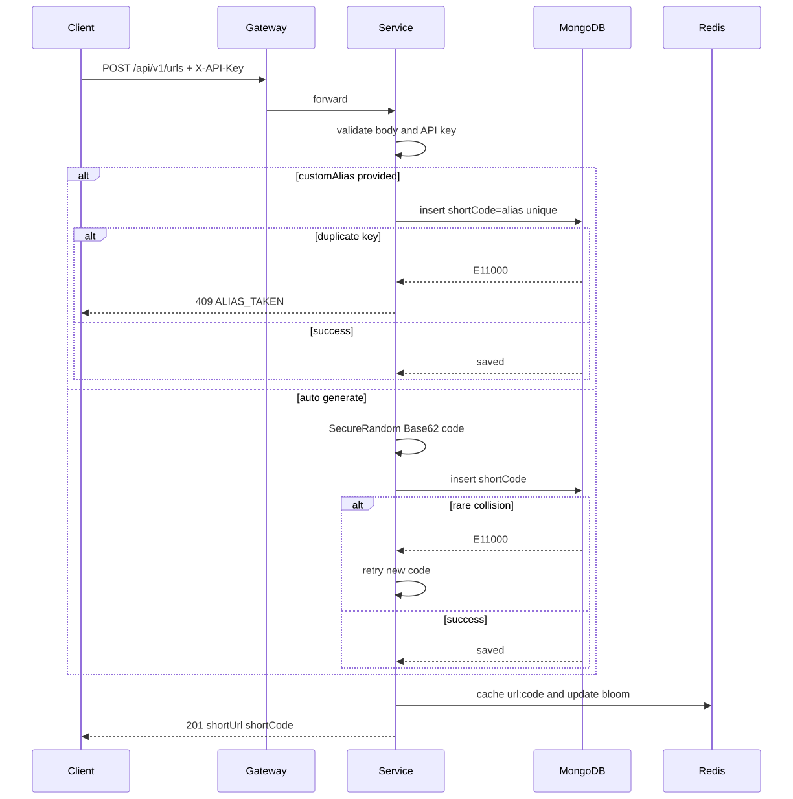
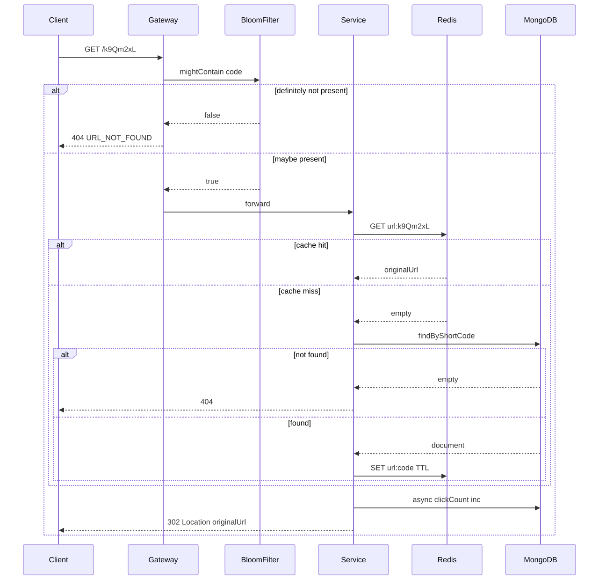
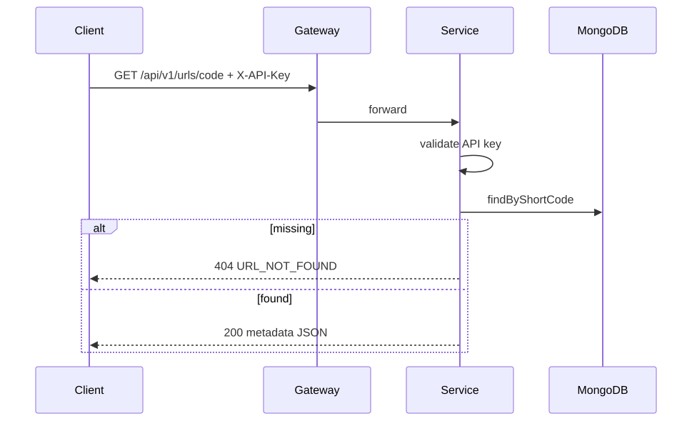

# URL Shortener

Spring Boot URL shortener with API gateway, MongoDB, Redis caching, random Base62 codes, and atomic custom-alias handling. Deployable on a DigitalOcean droplet with Docker Compose and GitHub Actions CI/CD.

## Architecture

```
Client
  └─► Gateway (:80) ── Bloom filter + rate limit
        └─► Service (:8081)
              ├─► MongoDB   (source of truth, unique shortCode)
              └─► Redis     (redirect cache + bloom bits)
```

| Module | Role |
|--------|------|
| `gateway/` | Spring Cloud Gateway — routes, rate limit, Bloom filter |
| `service/` | Create / redirect / metadata APIs |
| `k8s/` | Optional DOKS manifests |
| `docs/` | Droplet + GitHub Actions guides |

## Endpoints

| Method | Path | Auth | Result |
|--------|------|------|--------|
| `POST` | `/api/v1/urls` | `X-API-Key` | Create short URL (`201`) |
| `GET` | `/{shortCode}` | none | Redirect (`302`) |
| `GET` | `/api/v1/urls/{shortCode}` | `X-API-Key` | Metadata JSON |

### Request / response examples

**Create (random code)**

```bash
curl -s -X POST http://HOST/api/v1/urls \
  -H "Content-Type: application/json" \
  -H "X-API-Key: YOUR_API_KEY" \
  -d '{"url":"https://github.com/bachaadithya/urlshortner"}'
```

```json
{
  "shortCode": "k9Qm2xL",
  "shortUrl": "http://HOST/k9Qm2xL",
  "originalUrl": "https://github.com/bachaadithya/urlshortner",
  "custom": false,
  "createdAt": "2026-09-30T08:00:00Z"
}
```

**Create (custom alias)**

```bash
curl -s -X POST http://HOST/api/v1/urls \
  -H "Content-Type: application/json" \
  -H "X-API-Key: YOUR_API_KEY" \
  -d '{"url":"https://example.com/sale","customAlias":"blackfriday"}'
```

**Redirect**

```bash
curl -I http://HOST/blackfriday
# HTTP/1.1 302 Found
# Location: https://example.com/sale
```

**Metadata**

```bash
curl -s http://HOST/api/v1/urls/blackfriday \
  -H "X-API-Key: YOUR_API_KEY"
```

### PowerShell note

Use `curl.exe` and escaped quotes:

```powershell
curl.exe -s -X POST "http://HOST/api/v1/urls" `
  -H "Content-Type: application/json" `
  -H "X-API-Key: YOUR_API_KEY" `
  -d "{\"url\":\"https://example.com\"}"
```

## How it works

### Request lifecycle diagrams

**Create short URL** (`POST /api/v1/urls`)



**Redirect** (`GET /{shortCode}`)



**Metadata** (`GET /api/v1/urls/{shortCode}`)



**Data stores**



### 1. Custom alias collisions (race-safe)

Two users claiming `blackfriday` at the same time must not both succeed.

**Wrong approach:** check if alias exists → then insert (TOCTOU race).

**This app:** single atomic `insert` + MongoDB **unique index** on `shortCode`.

- Winner → `201 Created`
- Loser → Mongo `DuplicateKeyException` → `409` with code `ALIAS_TAKEN`

Code: `UrlService.insertCustomAlias`, index in `MongoIndexConfig` / `@Indexed(unique = true)`.

### 2. Building a short URL (auto)

If no `customAlias` is sent:

1. `RandomBase62ShortCodeGenerator` picks a **random** Base62 string (not sequential).
2. Insert into Mongo; on rare collision, retry.
3. Write Redis cache + Bloom filter.
4. Return response **only after** persist succeeds.
5. `shortUrl` = `PUBLIC_BASE_URL + "/" + shortCode`.

### 3. Redirection

`GET /{shortCode}`:

1. Gateway Bloom filter: unknown codes → `404` (no DB hit).
2. Service cache-aside: Redis `url:{code}` → else Mongo → populate Redis.
3. Return `302` with `Location: originalUrl`.
4. Click count incremented asynchronously with Mongo `$inc`.

### 4. Metadata

`GET /api/v1/urls/{shortCode}` loads the Mongo document and returns `shortCode`, `shortUrl`, `originalUrl`, `custom`, `createdAt`, `expiresAt`, `clickCount`.

### 5. Input validation

Bean Validation on `CreateUrlRequest` (`@Valid` in controller):

- `url` — required, http(s), max 2048 chars
- `customAlias` — optional, 3–32 chars, `[A-Za-z0-9_-]+`

Extra checks in `UrlService.validateCustomAlias` (reserved words like `api`, `health`).

### 6. Error handling

`GlobalExceptionHandler` maps exceptions to JSON:

| HTTP | Code | When |
|------|------|------|
| 400 | `VALIDATION_ERROR` / `INVALID_ALIAS` / `BAD_REQUEST` | Bad input |
| 401 | `INVALID_API_KEY` | Missing/wrong `X-API-Key` |
| 404 | `URL_NOT_FOUND` | Unknown short code |
| 409 | `ALIAS_TAKEN` | Custom alias already claimed |
| 503 | `SHORT_CODE_UNAVAILABLE` | Could not allocate random code |
| 500 | `INTERNAL_ERROR` | Unexpected failure |

## Quick start (local)

```bash
cp .env.example .env
# edit API_KEY / PUBLIC_BASE_URL if you want

docker compose up -d --build
docker compose ps

curl -s http://localhost/actuator/health
```

API base URL locally: `http://localhost` (gateway maps host **80** → container 8080).

API key: value of `API_KEY` in `.env` (default from `.env.example`).

### Unit tests

```bash
mvn -B test
```

## Droplet setup (DigitalOcean)

Full guide: [docs/DROPLET_SETUP.md](docs/DROPLET_SETUP.md)

```bash
ssh root@YOUR_DROPLET_IP

# Install Docker once
curl -fsSL https://get.docker.com | sh
ufw allow OpenSSH && ufw allow 80/tcp && ufw --force enable

# Clone and configure
git clone https://github.com/bachaadithya/urlshortner.git /opt/urlshortner
cd /opt/urlshortner
cp .env.example .env
nano .env   # PUBLIC_BASE_URL=http://YOUR_IP  and API_KEY=...

# Start (build one service at a time if RAM is low)
docker compose build service
docker compose build gateway
docker compose up -d
docker compose ps
```

Smoke test:

```bash
curl http://YOUR_IP/actuator/health

curl -s -X POST http://YOUR_IP/api/v1/urls \
  -H "Content-Type: application/json" \
  -H "X-API-Key: YOUR_API_KEY" \
  -d '{"url":"https://example.com"}'
```

## GitHub Actions CI/CD

| Workflow | When | Does |
|----------|------|------|
| CI | push/PR to `main` | Maven tests |
| CD | push to `main` | SSH → git pull → rebuild containers |

Setup secrets + SSH key: [docs/GITHUB_ACTIONS.md](docs/GITHUB_ACTIONS.md)

Required secrets: `DROPLET_HOST`, `DROPLET_USER`, `DROPLET_SSH_KEY`.

## Project layout

```text
gateway/     Spring Cloud Gateway + BloomFilterGatewayFilter
service/     REST APIs, UrlService, random Base62, Redis, Mongo
scripts/     deploy-droplet.sh
k8s/         optional Kubernetes manifests
docs/        droplet + CI/CD guides
.env.example environment template
```

## Useful commands

```bash
docker compose ps
docker compose logs -f gateway service
docker compose restart service gateway
grep API_KEY .env
```
